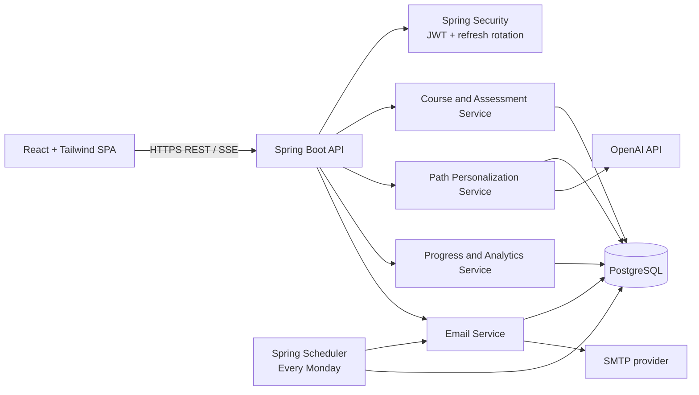
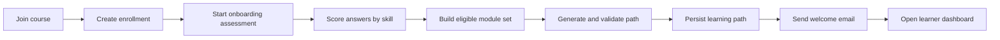
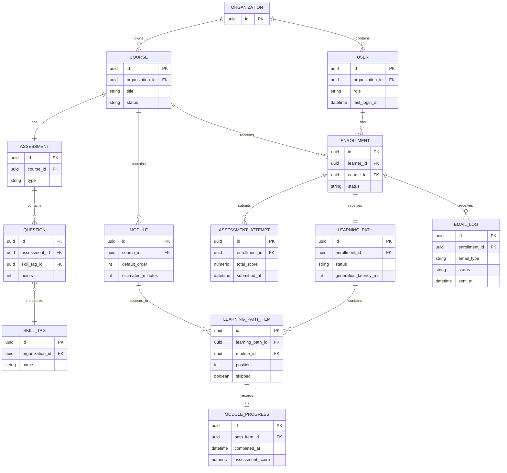

# RouteEd - Product Requirements and Technical Blueprint

**Version:** 1.0  
**Product type:** Multi-tenant B2B SaaS  
**Primary users:** EdTech providers, bootcamps, coaching institutes, and corporate L&D teams  
**Selected stack:** React + Tailwind CSS, Spring Boot, PostgreSQL, JPA/Hibernate, Spring Security JWT, OpenAI API, JavaMailSender/SMTP, Spring Scheduler

---

## 1. Product objective

RouteEd helps a training organization improve learner completion by creating a personalized sequence of course modules for every learner. The platform measures learner progress, identifies drop-off points, calculates a learner health score, and sends timely personalized emails.

### Success measures

| Measure | Definition |
| --- | --- |
| Course completion rate | Learners who complete every required module in their personal path / enrolled learners |
| Drop-off module | The module with the highest count of learners who stop progressing before the next module |
| Path personalization variance | Average difference between learners' personalized module sequences for the same course |
| Path-generation latency | Time from assessment submission to saved personal path, in milliseconds |
| Email delivery rate | Successfully sent emails / attempted emails |

---

## 2. Scope and roles

### Roles

| Role | Responsibilities |
| --- | --- |
| Platform administrator (optional future role) | Manages organizations and platform operations |
| Organization admin | Creates courses, modules, assessments, enrollments, and views organization analytics |
| Learner | Joins a course, takes the assessment, follows the generated path, and marks modules complete |

### MVP in scope

- Organization-aware authentication and authorization.
- Course, module, skill-tag, assessment, and question management.
- Learner enrollment and onboarding assessment.
- Skill scoring and personalized learning-path generation.
- Learner progress tracking and progress display.
- Welcome and weekly progress emails with delivery audit logs.
- Organization admin analytics, drop-off reporting, and health scores.

### Explicitly out of scope for MVP

- Payments, certificates, peer discussions, content hosting, and native mobile apps.
- Retaking assessments, A/B testing paths, CSV exports, and advanced organization billing.

---

## 3. System blueprint



### Design principles

1. **Tenant isolation:** every organization-owned record includes `organization_id`; all backend queries scope data to the authenticated user's organization.
2. **Deterministic before generative:** assessment scoring, prerequisites, and completion rules remain server-owned. The LLM receives only allowed modules and returns a structured recommendation plus explanation.
3. **Persist all decisions:** save the generated path, LLM latency, model metadata, and reasons for each skip/reorder action. A learner sees a stable path even if the LLM later changes.
4. **Secure by default:** short-lived access token, rotated refresh token stored securely, BCrypt/Argon2 password hashing, validation, rate limiting of AI endpoints, and audit-friendly email logs.

---

## 4. Functional modules

### M1. Identity, authentication, and access control

**Purpose:** securely authenticate users and enforce organization and role boundaries.

- Register organization admin and learner accounts.
- Login, refresh-token rotation, logout, and password reset (MVP may defer reset email).
- JWT access token contains user ID, organization ID, and roles.
- Frontend protected routes; backend `@PreAuthorize` / authorization checks.
- Record `last_login_at` after successful login.

**Core endpoints:** `POST /auth/register`, `POST /auth/login`, `POST /auth/refresh`, `POST /auth/logout`, `GET /me`.

### M2. Organization and course management

**Purpose:** enable admins to construct a course curriculum.

- Create, edit, publish, archive, and view courses.
- Create ordered modules with title, description, content URL/text, estimated minutes, difficulty, and prerequisite modules.
- Create reusable skill tags such as `arrays`, `java-basics`, or `leadership`.
- Map each module to one or more skill tags and a target proficiency level.
- Published courses cannot lose modules that existing learners have already started; archive instead.

**Core endpoints:** `GET/POST /courses`, `GET/PATCH/DELETE /courses/{courseId}`, `POST /courses/{courseId}/modules`, `PATCH /modules/{moduleId}`.

### M3. Assessment authoring and scoring

**Purpose:** measure a learner's baseline by skill domain.

- Attach one onboarding assessment to each course.
- Support MCQ questions in MVP; keep short-answer schema and manual/AI evaluation as a future extension.
- Map every question to one primary skill tag and assign points.
- Store attempt, selected answers, score, score by skill, start, and submission timestamps.
- Calculate `skillScore = earned points for skill / available points for skill * 100`.

**Core endpoints:** `POST /courses/{courseId}/assessments`, `GET /courses/{courseId}/onboarding-assessment`, `POST /enrollments/{enrollmentId}/assessment-attempts`.

### M4. Enrollment and learner onboarding

**Purpose:** move a learner through a reliable, measurable first-use journey.



- Learner joins one published course.
- Backend prevents duplicate active enrollment.
- Assessment is required before path generation.
- Path generation status: `PENDING`, `GENERATING`, `READY`, or `FAILED`.
- A failed generation shows a retry-safe message and does not discard assessment results.

### M5. AI path personalization

**Purpose:** produce a defensible, learner-specific curriculum route.

#### Input to path builder

- Ordered course modules, prerequisite relationships, difficulty, module skills, and target levels.
- Learner's skill scores.
- Server-calculated eligibility decision per module.

#### Required rule layer

- A module can be skipped only if every skill objective meets the configured mastery threshold (default: 80%) **and** no required module depends on it for unmastered content.
- A module cannot be moved before an unmet prerequisite.
- The generated sequence must include every non-skipped module exactly once.
- Backend validates the returned structured data before saving it.

#### LLM output contract

```json
{
  "orderedModuleIds": ["uuid-1", "uuid-2"],
  "skippedModules": [
    {"moduleId": "uuid-3", "reason": "Baseline score of 92% in Java fundamentals"}
  ],
  "learnerSummary": "Your route begins with collections because you already demonstrate core Java mastery."
}
```

**Core endpoint:** `POST /enrollments/{enrollmentId}/generate-path`.

### M6. Progress tracking

**Purpose:** record meaningful learner activity and present accurate progress.

- Learner marks only the current/available path module as complete.
- On completion, store a `module_progress` record with timestamps and optional post-module score.
- Calculate progress using required, non-skipped personalized-path modules.
- Poll `GET /enrollments/{id}/dashboard` initially; SSE can replace polling after MVP.
- Emit an internal domain event after completion for analytics recalculation.

**Core endpoints:** `GET /enrollments/{enrollmentId}/dashboard`, `POST /path-items/{pathItemId}/complete`.

### M7. Email automation

**Purpose:** reinforce learner engagement without losing operational traceability.

- Send a welcome email only after a path reaches `READY`.
- Run a scheduled job every Monday in the organization's preferred timezone (MVP default: `Asia/Kolkata`).
- Generate an individualized progress summary: completed modules, next module, pace, and supportive guidance.
- Log every email attempt with status `QUEUED`, `SENT`, `FAILED`, provider response, retry count, and timestamps.
- Do not include sensitive assessment details in email content.

### M8. Analytics and learner health

**Purpose:** let admins find risk and course-content problems early.

- Course-level total enrollment, active learners, completion rate, and average path-generation latency.
- Module funnel/drop-off counts calculated against each learner's personalized path position.
- Learner list with progress, last login, last activity, and health score.
- Health score recalculates after login, module completion, assessment scoring, and the weekly scheduler.

#### Learner Health Score

`healthScore = completionPace * 0.50 + loginRecency * 0.30 + averageModuleAssessmentScore * 0.20`

Each component is normalized to 0-100:

- `completionPace`: actual completed path items / expected completed path items by elapsed course time.
- `loginRecency`: 100 for a login in the last 2 days; linearly declines to 0 by day 30.
- `averageModuleAssessmentScore`: average post-module score; use 50 as neutral when no score exists and show this state in the UI.

Suggested status: `HEALTHY` >= 70, `AT_RISK` 40-69, `INACTIVE` < 40.

**Core endpoints:** `GET /admin/analytics/overview`, `GET /admin/courses/{courseId}/analytics`, `GET /admin/learners`.

---

## 5. Data model blueprint



### Required tables

| Table | Key fields and purpose |
| --- | --- |
| `organizations` | name, slug, timezone, status |
| `users` | organization_id, name, email, password_hash, role, last_login_at, enabled |
| `refresh_tokens` | user_id, token_hash, expiry, revoked_at, replacement_token_id |
| `courses` | organization_id, title, description, status, estimated_duration_days |
| `modules` | course_id, title, content_url, content_text, default_order, difficulty, estimated_minutes |
| `module_prerequisites` | module_id, prerequisite_module_id |
| `skill_tags` | organization_id, name, description |
| `module_skills` | module_id, skill_tag_id, required_level |
| `assessments` / `questions` / `answer_options` | authoring data and correct answers stored server-side only |
| `enrollments` | learner_id, course_id, status, enrolled_at, completed_at |
| `assessment_attempts` / `attempt_answers` / `skill_scores` | learner answers and score breakdown |
| `learning_paths` / `learning_path_items` | persisted AI result, position, skip decision, reason |
| `module_progress` | started_at, completed_at, module assessment score |
| `email_logs` | recipient, template type, status, retry count, provider message ID |
| `audit_logs` (recommended) | actor, action, entity type/id, timestamp |

---

## 6. Frontend blueprint

### Learner pages

1. Login and registration.
2. My courses / join-course screen.
3. Onboarding assessment.
4. Path-generation waiting state and failure/retry state.
5. Learner dashboard: personalized sequence, skip reasons, completion progress, next action.
6. Module content view and completion action.

### Admin pages

1. Login and organization overview.
2. Courses list and course editor.
3. Module editor with ordering, skills, prerequisites, and metadata.
4. Assessment/question editor.
5. Course analytics: completion, personalized funnel/drop-off, latency, email delivery.
6. Learner analytics: learner health, progress, last activity, and path status.

---

## 7. Backend package structure

```text
backend/src/main/java/com/routeed/
  auth/            # login, refresh token, security filters
  organization/    # tenant context and organization administration
  course/          # course, module, prerequisite, skill APIs
  assessment/      # assessments, questions, attempts, scoring
  enrollment/      # course joining and learner state
  personalization/ # rule evaluator, OpenAI client, path validator
  progress/        # completion events and dashboard calculations
  email/           # templates, SMTP sending, logs, retries
  analytics/       # metrics, drop-off logic, health score
  common/          # errors, validation, auditing, API response models
```

---

## 8. Security and non-functional requirements

- Enforce HTTPS in deployed environments; never commit secrets.
- Store access tokens in memory and refresh tokens in `HttpOnly`, `Secure`, `SameSite` cookies where frontend/backend domain design permits.
- Hash refresh tokens in the database; rotate and revoke them on reuse detection.
- Validate every request with Bean Validation and return a consistent error contract.
- Apply organization scoping in service/repository methods; never accept `organizationId` from a client as authority.
- Add rate limits to login and AI path-generation endpoints.
- Log structured errors without passwords, tokens, raw emails, or assessment answers.
- Use database migrations (Flyway) and transactional writes for assessment submission and module completion.
- Add unit tests for scoring, prerequisites, path validation, health score, and authorization; integration tests for core API workflows.

---

## 9. Delivery plan

| Phase | Deliverable | Acceptance criteria |
| --- | --- | --- |
| 0 - Foundation | Monorepo, environment templates, PostgreSQL, Flyway, CI | App starts locally; migrations apply; README explains setup |
| 1 - Auth + courses | JWT/roles plus course/module/skill CRUD | Admin cannot access another organization; learner cannot edit courses |
| 2 - Assessment + enrollment | Course joining, questions, attempts, skill scoring | Skill-score breakdown matches a known test fixture |
| 3 - Personalized path | Rules, LLM adapter, schema validation, saved path | Returned path has valid prerequisites and a skip reason for every skipped item |
| 4 - Learner progress | Dashboard and module completion | Progress equals completed required items / required personalized items |
| 5 - Email + analytics | Welcome job, Monday job, logs, metrics, health score | Email attempt is auditable; admin sees accurate funnel and health score |
| 6 - Hardening + deploy | Validation, tests, monitoring, Railway/Render + Vercel deploy | Demo environment is secure, responsive, and documented |

---

## 10. MVP acceptance walkthrough

1. An organization admin registers and creates a course with modules, prerequisites, skills, and an onboarding assessment.
2. A learner registers, joins that course, and submits the assessment.
3. RouteEd calculates skill scores, generates a validated learning path, stores it, and sends a welcome email.
4. The learner completes modules in the personalized order and sees updated progress.
5. The Monday scheduler sends a logged weekly progress email.
6. The admin sees learner completion, current health status, and the module where progression most frequently stops.

---

## 11. Decisions needed before implementation

1. Will learners self-register, be invited by admins, or both?
2. Will course content live as external links, uploaded files, rich text, or a combination?
3. What is the default mastery threshold for skipping content (recommended 80%)?
4. Is one organization allowed to have multiple admins (recommended yes)?
5. Which email provider and OpenAI model/account will be used for development and production?
